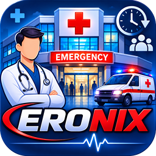
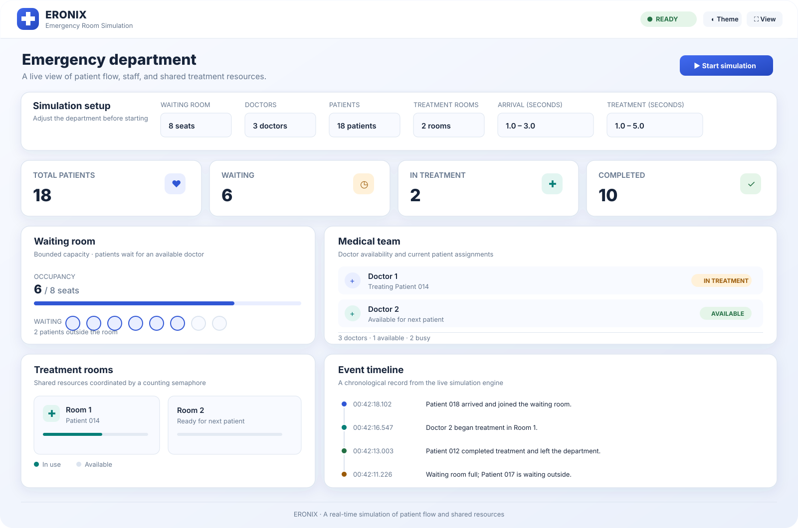

  

  # 🏥 ERONIX
  ### Real-Time Emergency Department Simulation Engine

  

    
    
    
    
    
  

  
<strong>A robust, cross-platform simulation system bringing concurrent operating system concepts and emergency department workflows to life.</strong>

---

## 🎯 Overview

**ERONIX** is an advanced simulation application engineered to model the dynamic, high-pressure environment of a hospital emergency department. Built with a unified, high-performance Java core engine, it bridges theory and practice by simulating real-time triage, waiting room capacities, doctor allocation, and treatment room bottlenecks.

Whether you are exploring multi-threaded synchronization or observing how patient queues shift under different loads, ERONIX offers a clean, responsive graphical experience across both desktop and mobile devices.

> **Disclaimer:** ERONIX is an educational and architectural demonstration tool. It is not intended for clinical deployment or medical decision-making.

---

## 🖥️ Application Preview

  

The desktop control center featuring live telemetry, capacity tracking, and chronological event logging.

---

## ✨ Core Highlights

- **Unified Simulation Engine:** A shared Java core handles all concurrency, state updates, and resource management uniformly across platforms.
- **Cross-Platform Delivery:** Native packages built specifically for Windows (`.msi`), Linux (`.deb` / `.rpm`), and Android (`.apk`).
- **Concurrency in Action:** Directly visualizes critical OS concepts like semaphores, mutexes, bounded buffers, and thread lifecycles.
- **Adaptive Interface Themes:** Fully custom Light and Dark mode stylesheets built for readability during long monitoring sessions.
- **Comprehensive Mobile Control:** The Android application neatly sections functionality into dedicated Home, Waiting, Team, Events, and Settings panels.

---

## 📦 Downloads (v1.0.3 Releases)

Select the package corresponding to your operating system:

| Platform | Format | Action Link |
| :--- | :--- | :--- |
| **Windows** | MSI Installer | [Download ERONIX.msi](https://github.com/EngOmarAbd-Elaziz/ERONIX/releases/download/v1.0.3/ERONIX.msi) |
| **Fedora / RHEL** | RPM Package | [Download ERONIX.rpm](https://github.com/EngOmarAbd-Elaziz/ERONIX/releases/download/v1.0.3/ERONIX.rpm) |
| **Ubuntu / Debian** | DEB Package | [Download ERONIX.deb](https://github.com/EngOmarAbd-Elaziz/ERONIX/releases/download/v1.0.3/ERONIX.deb) |
| **Android (14+)** | APK Package | [Download ERONIX.apk](https://github.com/EngOmarAbd-Elaziz/ERONIX/releases/download/v1.0.3/ERONIX.apk) |

---

## ⚙️ Under the Hood: How It Works

ERONIX translates theoretical concurrency problems into a tangible, observable workflow:

1. **Patient Generation:** Incoming patients spawn as individual worker threads according to your customized arrival frequency.
2. **Bounded Buffer Queuing:** The waiting room functions as a synchronized bounded buffer. Custom `empty`, `full`, and `mutex` semaphores coordinate patient entry and doctor selection safely.
3. **Staff Coordination:** Active doctor threads evaluate the queue and pull patients forward, instantly requesting an available treatment space.
4. **Shared Resource Allocation:** Counting semaphores govern access to limited treatment rooms. Once care concludes, the room unlocks for the next queue member.
5. **Real-Time Telemetry:** The engine streams state snapshots and chronological activity events straight to the UI dashboard without artificial animation hacks.

---

## 📐 Architecture & Technology Stack

| Layer | Technologies & Tooling |
| :--- | :--- |
| **Core Logic** | Java (Shared Simulation Engine) |
| **Desktop Client** | Java 25, JavaFX, Maven |
| **Mobile Client** | Java, Android SDK, Gradle |
| **Styling & Assets** | Custom CSS Themes, SVG Vectors, PNG Icons |

---

## 👨‍💻 Creator & Developer

Designed, engineered, and maintained by **Eng. Omar Abdelaziz**

  <a href="https://engomarabd-elaziz.github.io/My-Portofolio/">🌐 Portfolio</a>
  &nbsp;·&nbsp;
  <a href="https://github.com/EngOmarAbd-Elaziz">💻 GitHub</a>

 

Crafted with passion to make concurrent systems visible, interactive, and impactful.

