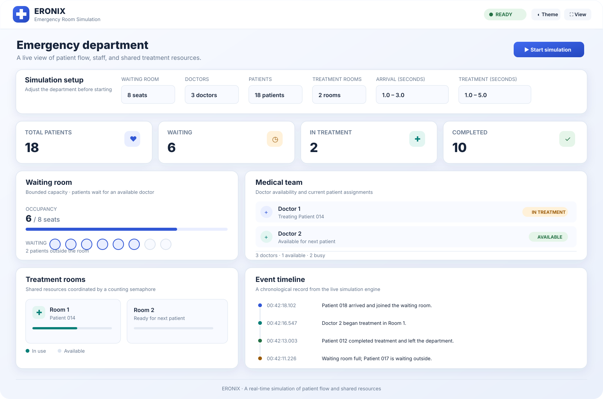

<div align="center">
  
  <h1>ERONIX v1.0.1</h1>
  <p><strong>Emergency room simulation for Windows, Linux, and Android.</strong></p>
</div>

---

ERONIX brings a live hospital emergency department simulation to your desktop
or Android device. Watch patient flow, waiting-room capacity, doctors, and
treatment rooms update from a shared Java simulation engine.



<p align="center"><sub>Illustrative dashboard preview; figures shown are sample UI content.</sub></p>

## Download

| Platform | Package | Install / launch |
|---|---|---|
| **Windows** | [ERONIX-windows.zip](https://github.com/EngOmarAbd-Elaziz/ERONIX/releases/download/v1.0.1/ERONIX-windows.zip) | Extract and run `ERONIX/ERONIX.exe`. |
| **Linux x86_64** | [ERONIX-linux.tar.gz](https://github.com/EngOmarAbd-Elaziz/ERONIX/releases/download/v1.0.1/ERONIX-linux.tar.gz) | Extract and run `ERONIX/bin/ERONIX`. |
| **Android 14+** | [ERONIX-android.apk](https://github.com/EngOmarAbd-Elaziz/ERONIX/releases/download/v1.0.1/ERONIX-android.apk) | Open the APK on your device and allow installation from your download source. |

The Windows and Linux packages include a Java runtime. No separate Java or
JavaFX installation is needed.

## Highlights

- Live patient, waiting-room, doctor, and treatment-room status.
- Chronological event timeline driven by the simulation engine.
- Configurable department capacity, staffing, patient volume, and timings.
- Light and dark themes on desktop.
- Native Android dashboard with Home, Waiting, Team, Events, and Settings
  pages; supports portrait and landscape layouts.
- Demonstrates Java threads, bounded buffers, semaphores, and resource
  coordination.

## Requirements

- **Windows / Linux:** compatible x86_64 system. Packages are built natively
  for their target operating system.
- **Android:** Android 14 (API 34) or newer.

## Build from source

Desktop builds require JDK 25+ and Maven 3.9+. Android builds require JDK 17
and Android SDK Platform 35.

```bash
# Desktop tests
mvn clean verify

# Android tests and debug APK
cd android
./gradlew testDebugUnitTest assembleDebug
```

See the [project README](../../README.md) for complete build and simulation
details.
