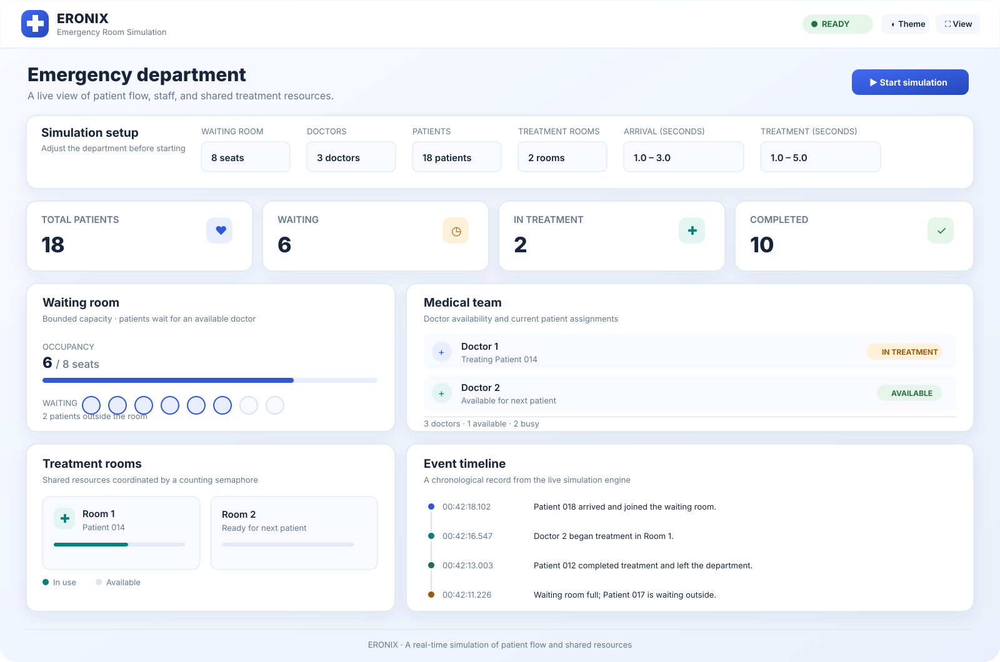

  
  <h1>ERONIX v1.0.4</h1>
  
<strong>A clearer view of every simulation—from patient flow to final outcomes.</strong>

---

Illustrative interface preview; data shown is sample UI content.

## What’s new

- **Simulation report on desktop and Android** with patient outcome distribution,
  a patient-flow bar chart, and a treatment-duration histogram.
- **Useful run statistics** including completion rate, average treatment time,
  simulation duration, event count, and warnings.
- **Export to Word** as a `.docx` document with the report narrative, metric
  tables, outcome shares, and text-based chart representations.
- **More reliable release publishing:** the release workflow now stops instead
  of publishing a partial release if Android signing is not configured.

## Downloads

| Platform | Package | Download |
|---|---|---|
| Windows | MSI installer | [ERONIX-windows.msi](https://github.com/EngOmarAbd-Elaziz/ERONIX/releases/download/v1.0.4/ERONIX-windows.msi) |
| Ubuntu / Debian | DEB package | [ERONIX-linux.deb](https://github.com/EngOmarAbd-Elaziz/ERONIX/releases/download/v1.0.4/ERONIX-linux.deb) |
| Fedora / RHEL | RPM package | [ERONIX-linux.rpm](https://github.com/EngOmarAbd-Elaziz/ERONIX/releases/download/v1.0.4/ERONIX-linux.rpm) |
| Linux x86_64 | AppImage | [ERONIX-linux-x86_64.AppImage](https://github.com/EngOmarAbd-Elaziz/ERONIX/releases/download/v1.0.4/ERONIX-linux-x86_64.AppImage) |
| Android 14+ | APK | [ERONIX-android.apk](https://github.com/EngOmarAbd-Elaziz/ERONIX/releases/download/v1.0.4/ERONIX-android.apk) |

The Windows installer and Linux application packages are built on their native
GitHub Actions runners. The Android package is signed using the repository’s
release signing secrets. If Android signing is unavailable, the release job
fails instead of creating a release that is missing the Android package.

## Verification

- Desktop: `mvn clean verify`
- Android: `cd android && ./gradlew testDebugUnitTest assembleDebug`
